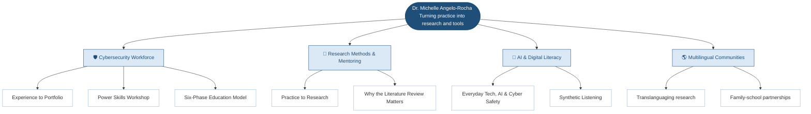

# Hi, I'm Dr. Michelle Angelo-Rocha

**Cyber Research Analyst at Cyber Florida, USF · Researcher and educator in cybersecurity workforce, AI, and multilingual communities**

I help communities often left out of technology and research, including immigrant families, older adults, and career changers, build the skills and confidence to thrive in a digital, AI-driven world.



## What I Work On

* Cybersecurity workforce development and education for adult learners, older adults, and K-12 students
* AI literacy and ethics, including AI in qualitative research
* Emergent multilingual immigrant learners and families and their paths into school and the workforce
* Community-based, trauma-informed, and arts-based research

## Currently Working On

* A paper on my cybersecurity and AI literacy course for older adults
* Synthetic Listening, on avatar-mediated interviews and AI translation in qualitative research
* Future research on AI natives: supporting children growing up with AI, together with their families

## Featured Projects

### 🛡️ Cybersecurity Workforce and Careers

**Experience to Portfolio**
A free guided toolkit that helps students and career changers turn their experience into portfolio entries employers can see.

**Power Skills Workshop**
Your Cert Opens the Door. Your Power Skills Get You the Seat. Workshop materials on power skills for cybersecurity students.

### 🔬 Research Methods and Mentoring

**Practice to Research Toolkit**
Free, visual guides that help student researchers, leaders, and community organizations plan ethics and IRB before collecting data. Includes one-page handouts in English, Spanish, and Portuguese.

**Why the Literature Review Matters**
What two years of slow reading taught me: a visual guide for students on building expertise, reading in layers, and using AI without losing the thinking.

### 🤖 AI and Digital Literacy

**Everyday Tech, AI and Cyber Safety: Building Confidence in a Digital World**
A 3-week course helping older adults stay safe online and use AI with confidence.
🔒 Materials are private for now and will be shared soon.

### 🌎 Multilingual Communities

My research with emergent multilingual families and educators appears in the publications below. Tools and materials are coming soon.

## Selected Publications

* Angelo-Rocha, M., Oliveira de Paula, K., Guidio Alves de Oliveira, C. R., Donley, K., & Braunstein, L. (2026). 'Essa é a nossa luta!' Educators' perspectives on translanguaging as an inclusive pedagogy for Indigenous and refugee multilingual learners in Brazilian public schools. *The Language Learning Journal, 54*(3). DOI
* Oliveira de Paula, K., Angelo-Rocha, M., Janerrandra, M., & de Oliveira, C. R. G. A. (2026). Translanguaging as resilience: Trauma-informed and culturally sustaining education for Venezuelan Indigenous refugee students in Brazil's public schools. *International Electronic Journal of Elementary Education, 18*(2), 203-221.
* Angelo-Rocha, M. (2026). Centering families, building bridges: Supporting multilingual children through school-community partnerships. In *Family Engagement in Education* (pp. 116-132). Routledge.
* Angelo-Rocha, M., & CyberBay Workforce Development Working Group (2026). *Modernizing the U.S. Cyber Talent Pipeline for the AI Era: A Multi-Sector Workforce Study and Regional Alignment Plan for Tampa Bay* [Research Report]. Cyber Florida at USF. ResearchGate
* Angelo-Rocha, M., [CO-AUTHORS]. (2025). *It Takes More Than a Certificate: A Holistic Model for Cyber Workforce Education & Program Evaluation* [Research Report]. Cyber Florida at USF. ResearchGate

📑 Full list of publications: Google Scholar · ResearchGate · ORCID

## Background

* PhD, Educational Leadership and Policy Studies, University of South Florida
* MA, Latin American and Caribbean Studies, University of South Florida
* BA, Mass Communications and Journalism, Universidade Católica de Brasília
* Adjunct Professor, USF College of Education
* Co-built CyberWorks, a cybersecurity training program for veterans, first responders, and career changers
* Developed the Six-Phase Cybersecurity Education Model

## Skills

* **Qualitative research:** interviews, focus groups, community-based, trauma-informed, and arts-based methods
* **Surveys:** closed and open-ended question design
* **Program and curriculum design:** cybersecurity education, mentorship programs, Six-Phase Cybersecurity Education Model
* **Teaching:** doctoral qualitative methods courses and AI and cyber safety classes for older adults
* **Grant development:** finding, screening, and writing grant proposals
* **Research ethics:** IRB protocol development
* **AI tools:** using AI in teaching and research, responsibly
* **Open educational resources:** GitHub, Markdown, and visual guides
* **Languages:** Portuguese (native), English (fluent), Spanish (basic)

## Let's Connect

* Email: michelleangelorocha@gmail.com
* LinkedIn: linkedin.com/in/michelleangelo-rocha
* Google Scholar: Michelle Angelo-Rocha
* ResearchGate: Michelle Angelo-Rocha
* ORCID: 0000-0002-3504-9053
````
